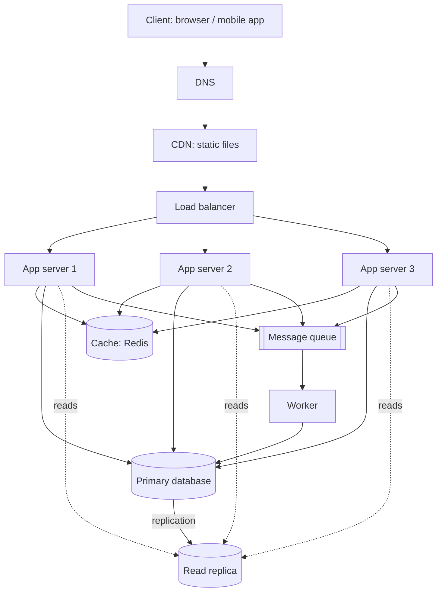

# QuickNotes Architecture

## Requirements

### Functional
- Users can register, log in and log out.
- Users can create, read, update and delete their own notes.
- Users can organise notes with tags and filter by tag.
- Users can list their notes, newest first, with pagination.
- Optional background work: email notifications and search indexing after a note is saved.

### Non-functional
- **Availability:** 99.9% uptime; no single point of failure.
- **Latency:** `GET /notes` under 200 ms at the 95th percentile.
- **Scalability:** support 1 million users and grow by adding servers.
- **Durability:** a saved note is never lost (replicated database, daily backups).
- **Security:** HTTPS everywhere, hashed passwords, users can only access their own notes.
- **Consistency:** a user sees their own new note immediately (read-your-writes).

## Load estimate (1 million users)

Assumptions: 20% of users are active each day (200,000 daily active users, DAU); each active user reads notes 20 times and creates 2 notes per day; average note is about 1 KB; peak traffic is 5× the average.

| Metric | Calculation | Result |
|--------|-------------|--------|
| Reads per day | 200,000 × 20 | 4,000,000 |
| Average reads/second | 4,000,000 ÷ 86,400 | ~46 reads/s |
| **Peak reads/second** | 46 × 5 | **~230 reads/s** |
| Writes per day | 200,000 × 2 | 400,000 |
| Average writes/second | 400,000 ÷ 86,400 | ~4.6 writes/s |
| **Peak writes/second** | 4.6 × 5 | **~25 writes/s** |
| Notes per year | 400,000 × 365 | ~146 million |
| **Storage per year** | 146M × 1 KB | **~146 GB** (about 220 GB with indexes) |

Read-to-write ratio is about 10:1, so caching and read replicas pay off. These loads are modest: the design focuses on availability more than raw throughput.

## Architecture diagram



ASCII version:

```
Client -> DNS -> CDN (static) 
                  |
            Load balancer
          /       |       \
     App 1     App 2     App 3
        \         |         /
         +--> Cache (Redis) 
         +--> Primary DB ==replication==> Read replica (reads)
         +--> Queue --> Worker --> Primary DB
```

## What each component does

- **Client:** the browser or app where users view and edit notes, calling the API over HTTPS.
- **DNS:** translates `api.quicknotes.com` into the load balancer's address, and can route around a failed region.
- **CDN:** serves static files (HTML, CSS, JS) from locations near the user, reducing latency and server load.
- **Load balancer:** spreads requests across app servers and removes unhealthy ones, so no single server is overloaded or fatal.
- **App servers (3):** stateless servers running the API logic, so we scale by adding more and survive the loss of one.
- **Cache (Redis):** keeps recent note lists in memory so repeated reads skip the database and respond in milliseconds.
- **Primary database:** the single source of truth that handles all writes with consistent, durable storage.
- **Read replica:** a copy of the primary that serves read queries, offloads the primary and can be promoted if the primary fails.
- **Queue:** accepts slow tasks (emails, search indexing) instantly so the API can respond without waiting for them.
- **Worker:** processes queued jobs in the background, retrying failures without affecting users.

## Request flows

### GET /notes
1. The client sends `GET /v1/notes?limit=10` with its token.
2. DNS resolves the API hostname; the request reaches the load balancer.
3. The load balancer forwards it to a healthy app server.
4. The app server validates the token and identifies the user.
5. It checks the cache for key `notes:user:17:page1`.
6. **Cache hit:** return the cached JSON immediately (step 9).
7. **Cache miss:** query the **read replica** for the user's newest 10 notes.
8. Store the result in the cache with a short TTL (e.g. 60 seconds).
9. Return `200 OK` with the JSON list to the client.

### POST /notes
1. The client sends `POST /v1/notes` with JSON and its token.
2. DNS and the load balancer route it to an app server.
3. The app server validates the token and the input (title required, max 100 characters); invalid input returns `400`.
4. It inserts the note (and tag links) into the **primary database** in one transaction.
5. It deletes the user's cached note lists, so the next read is fresh.
6. It puts a "note created" job on the **queue** (search indexing, notifications).
7. It returns `201 Created` with the new note and a `Location` header.
8. A **worker** later picks up the job and processes it in the background; failures are retried and do not affect the response.

## Trade-offs

1. **Cache freshness vs speed.** Cached lists can be briefly stale. We invalidate the cache on writes and use a short TTL, so users see their own changes immediately while still taking load off the database.
2. **Read replica lag vs primary load.** Replicas can lag by milliseconds to seconds. We accept this for normal list reads but read from the primary right after a write when read-your-writes matters.
3. **Queue (eventual consistency) vs simplicity.** Background work makes the API faster and more resilient, but notifications and search indexing happen slightly later and add an extra component to run.
4. **SQL consistency vs horizontal write scaling.** One primary is simple and consistent, but writes cannot scale beyond it. At about 25 writes/s peak this is fine; later we can shard by `user_id`.

## Avoiding single points of failure

- **DNS and CDN:** managed services with multiple providers or points of presence.
- **Load balancer:** run a redundant pair (active/standby or managed multi-zone).
- **App servers:** at least three stateless servers in different availability zones; the load balancer drops failed ones.
- **Cache:** Redis with a replica and automatic failover; if the cache is lost, requests fall back to the database.
- **Database:** the read replica can be promoted to primary automatically; daily backups and point-in-time recovery protect data.
- **Queue and worker:** a managed, replicated queue with several workers; unfinished jobs are re-delivered if a worker dies.
